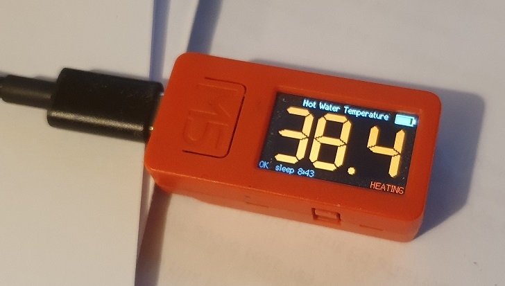

# M5Stick Heating Display

Firmware for an **M5StickC Plus 1.1** that shows the hot water temperature from a local JSON endpoint. The endpoint is provided by EBUSD which reads the data from a Vaillant boiler (see `https://github.com/congoblue/ebuslogger`).



The purpose of this is to have a small display in the bathroom for shower users so they can see when the stored hot water is about to run out!

## Features

- Connects to WiFi and fetches `http://192.168.1.240:8080/data` every 10 seconds
- Displays `v65.messages.State.fields.temp.value` in a large 7-segment font
- Temperature colour shifts from blue (10°C and below) through cyan, green and yellow to red (42°C and above)
- Battery icon in the top-right: green above 25%, yellow 10–25%, red below 10%
- Status line with a countdown to sleep (bottom left)
- "HEATING" shown in red (bottom right) while the boiler state is `water` (heating the hot water)
- Stays awake for 10 minutes, then deep-sleeps to save battery
- Press large M5 button to wake from sleep, or to extend sleep timer when awake. Hold M5 button to sleep.

## Controls

| Button | Action |
|---|---|
| Large front button (M5) | Wake from sleep; short press resets the 10-minute sleep timer; hold 2 s to sleep |
| Small side button | Step through backlight brightness (remembered across sleep) |

## Setup

1. Install [PlatformIO](https://platformio.org/) (e.g. the VS Code extension).
2. Copy `src/credentials.example.h` to `src/credentials.h` and enter your WiFi SSID and password.
   `credentials.h` is git-ignored.
3. If needed, change `DATA_URL` at the top of `src/main.cpp`.
4. Connect the M5StickC Plus over USB and upload:

   ```
   pio run -t upload
   ```

   Serial output (115200 baud) is available with `pio device monitor`.

## Configuration

Settings in `src/main.cpp`:

| Setting | Default | Purpose |
|---|---|---|
| `DATA_URL` | `http://192.168.1.240:8080/data` | JSON endpoint |
| `UPDATE_INTERVAL_MS` | 10 s | How often the temperature is fetched |
| `AWAKE_TIME_MS` | 10 min | Time before automatic sleep |
| `BRIGHTNESS_LEVELS` | 32, 80, 128, 192, 255 | Backlight steps (0–255) |
| `tHot` / `tCold` in `tempColour()` | 42°C / 10°C | Colour scale limits |

## Status messages

| Message | Meaning |
|---|---|
| `OK` | Last fetch succeeded |
| `No WiFi` | Could not connect to WiFi within 15 s |
| `HTTP <code>` | Server returned an error (negative codes are connection failures) |
| `JSON err` | Response was not valid JSON |
| `No temp` | JSON did not contain the expected temperature field |

## Libraries

- [M5Unified](https://github.com/m5stack/M5Unified)
- [ArduinoJson](https://arduinojson.org/) v7
